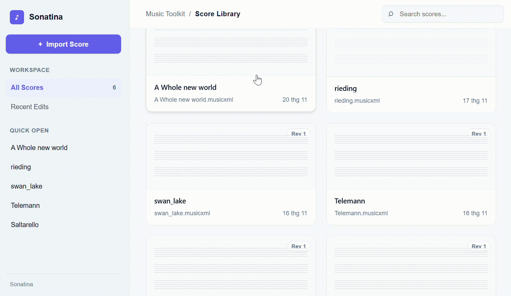

# Sonatina

Sonatina is a local-first web app for importing, viewing, analyzing, and
playing MusicXML scores. It also keeps a local project library with export and
revision information.



## Techstack

- FastAPI
- Verovio
- Music21
- React

## Feature

- Import and validate `.musicxml`/`.xml` files up to 15 MB
- Render music scores as page-based SVG
- Play score audio with adjustable tempo
- Inspect score key, time signature, tempo, parts, and selected notes
- Navigate pages, zoom the score, and seek by measure
- Create and manage local projects
- Export MusicXML and delete projects

## Run locally

Install the Python dependencies in `.venv` and the frontend dependencies in
`frontend`, then run:

```sh
make dev
```

This builds the React app and starts FastAPI at `http://127.0.0.1:8765`.

## Build the Windows installer

On a 64-bit Windows machine, install Python, Node.js, and Inno Setup 6, then
run PowerShell from the repository:

```powershell
.\packaging\windows\build.ps1
```

The script builds React, bundles the local FastAPI server with PyInstaller,
and creates `release\Sonatina-Setup.exe`. The installed app starts a local-only
server and opens it in the default browser. Projects are stored in the user's
application data directory (`%LOCALAPPDATA%\Sonatina` on Windows), separately
from the installation directory.

